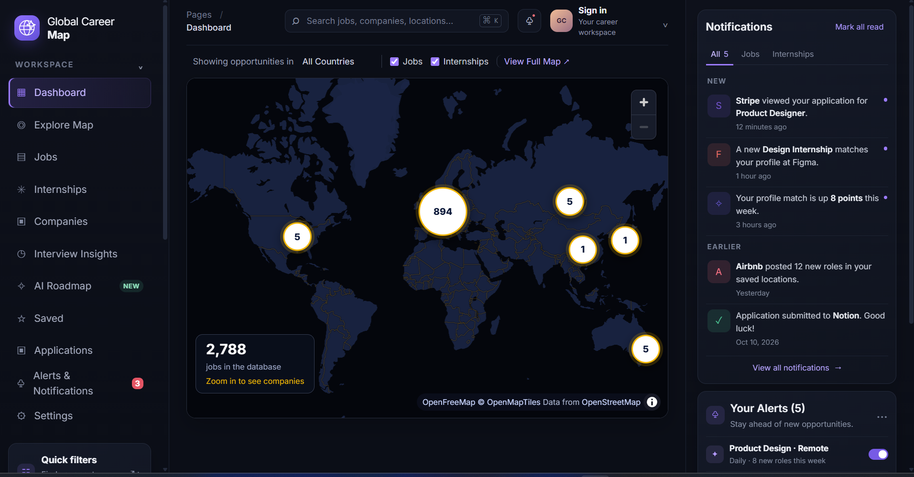
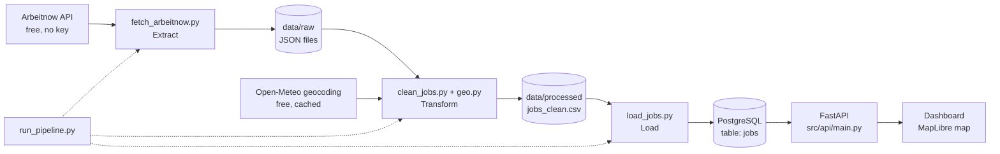

# Global Job Market Intelligence Pipeline

An end-to-end **data engineering** project: it collects real job postings from a free public API, cleans them, finds where each job is on the map, stores everything in **PostgreSQL**, serves it through a small **REST API**, and shows it on an interactive **world map dashboard**.

Zoomed out, the map shows how many jobs each country has. Zoom in, and company logos appear in the cities where they are hiring.



## What this project shows

- **ETL pipeline**: Extract (API) -> Transform (pandas) -> Load (PostgreSQL), started with one command.
- **Data cleaning**: free-text locations turned into city, country and coordinates; job type and work mode detected from titles and descriptions; duplicates removed.
- **Geocoding with a cache**: every city is looked up online only once, so re-runs are fast and polite to the free service.
- **Safe re-runs (idempotent loads)**: running the pipeline again updates existing jobs instead of creating duplicates.
- **REST API** with filters, built with FastAPI, using parameterised SQL (no SQL injection).
- **Interactive dashboard**: MapLibre vector map, country bubbles, company logos, popups with real jobs.
- **Automated tests** with pytest: 70 tests, no internet and no database needed.

## Architecture



More detail (data model, design decisions) is in [docs/architecture.md](docs/architecture.md).

## Tech stack

| Part | Tools |
|---|---|
| Language | Python 3.14 |
| Data processing | pandas |
| Database | PostgreSQL 18, SQLAlchemy, psycopg2 |
| API | FastAPI, Uvicorn |
| Dashboard | HTML, CSS, JavaScript, MapLibre GL |
| Testing | pytest |
| Free data services | Arbeitnow (jobs), Open-Meteo (geocoding), OpenFreeMap (map tiles), Logo.dev (company logos, optional) |

No packages are installed automatically by this project setup.
No paid APIs are needed.

## Project structure

```text
Global-Job-Market-Pipeline/
|-- src/
|   |-- ingestion/fetch_arbeitnow.py   # Step 1: download jobs -> data/raw
|   |-- transformation/
|   |   |-- clean_jobs.py              # Step 2: clean the jobs -> data/processed
|   |   `-- geo.py                     # locations, countries, city coordinates
|   |-- database/
|   |   |-- connection.py              # reads .env, creates the database engine
|   |   `-- load_jobs.py               # Step 3: save jobs in PostgreSQL
|   |-- api/main.py                    # REST API for the dashboard
|   `-- run_pipeline.py                # runs steps 1-3 with one command
|-- sql/001_create_tables.sql          # the "jobs" table
|-- ui/                                # dashboard (index.html, style.css, app.js)
|-- tests/                             # pytest tests
|-- docs/                              # architecture notes and screenshots
|-- data/raw, data/processed           # generated data (not stored in Git)
|-- .env.example                       # settings template (no real passwords)
|-- requirements.txt
`-- pytest.ini
```

## Getting started (Windows, PowerShell)

### 1. Requirements

- Python 3.12 or newer (developed with 3.14)
- PostgreSQL (with pgAdmin) installed and running
- Git

### 2. Download the project and install the packages

```powershell
git clone https://github.com/YOUR_USERNAME/Global-Job-Market-Pipeline.git
cd Global-Job-Market-Pipeline
python -m venv venv
.\venv\Scripts\Activate.ps1
pip install -r requirements.txt
```

If PowerShell says that scripts are disabled, run `Set-ExecutionPolicy -Scope CurrentUser RemoteSigned` once and try again.

### 3. Create the database and the settings file

1. In pgAdmin, create an empty database called `job_market`.
2. Copy the settings template and fill in your own values:

```powershell
Copy-Item .env.example .env
```

```text
DB_HOST=localhost
DB_PORT=5432
DB_NAME=job_market
DB_USER=postgres
DB_PASSWORD=your_password_here
```

The `.env` file is ignored by Git, so your password is never uploaded.

### 4. Run the pipeline

```powershell
python src/run_pipeline.py
```

This downloads about 1,500 jobs, cleans them, finds city positions (the first run needs a few minutes for the city lookups, later runs are fast) and saves them in PostgreSQL. Each run is also written to `logs/pipeline.log`.

Options: `--skip-fetch` (use the newest file already in `data/raw`) and `--no-geocoding` (skip the online city lookup).

### 5. Start the API

```powershell
uvicorn src.api.main:app --reload
```

Open <http://127.0.0.1:8000/docs> to try the endpoints. Leave this terminal running.

### 6. Open the dashboard

In a second terminal:

```powershell
python -m http.server 5500 --directory ui
```

Then open <http://127.0.0.1:5500/index.html>. (In VS Code you can also use the Live Server extension and open `ui/index.html`.)

**Company logos (optional):** create a free account at [logo.dev](https://logo.dev), copy the *publishable* key (it starts with `pk_`) and paste it into `LOGO_DEV_TOKEN` at the top of `ui/app.js`. Without a key, a coloured letter is shown instead of a logo. Never put a secret key in the dashboard code.

### 7. Run the tests

```powershell
pytest
```

## API endpoints

| Endpoint | What it returns |
|---|---|
| `GET /health` | API and database check |
| `GET /jobs` | Jobs, newest first. Filters: `country`, `city`, `company`, `job_type`, `work_mode`, `search`, `limit`, `offset` |
| `GET /stats` | Totals for the dashboard (jobs, new today, companies, countries) |
| `GET /companies` | Companies with the most open jobs (optional `country`) |
| `GET /map-markers` | One marker per country with the number of jobs |
| `GET /company-markers` | Companies per city inside the visible map area |

## Data model

One table, `jobs` (see `sql/001_create_tables.sql`):

| Column | Meaning |
|---|---|
| `job_id` | unique id from the source (primary key) |
| `title`, `company`, `skills`, `url` | job details (`url` is unique) |
| `country`, `city` | worked out from the free-text location |
| `work_mode` | Remote, Hybrid or On-site |
| `job_type` | Internship, Full-time, Part-time or Contract |
| `latitude`, `longitude` | position of the city (or of the country if the city is unknown) |
| `location_precision` | `city`, `country` or `none` |
| `posted_at`, `loaded_at` | when the job was posted and when it was saved |

## Known limitations

- **One data source.** The jobs come from Arbeitnow, which is strongest in Germany and neighbouring countries, so the map is Europe-heavy. More sources would make it more global.
- **"Where the company is" means "where the job is".** The source gives the job location, not the company address.
- **About 80% of the jobs get a city position.** The rest are remote jobs or have no usable location.
- **Old jobs stay in the database.** Jobs that disappear from the source are not marked as closed yet.
- The sidebar, notifications and alerts panels of the dashboard are design placeholders and are not connected to data.

## Ideas for the future

- Add more free job sources.
- Mark jobs that disappeared from the source as closed.
- Skills statistics (most wanted skills per country).
- Docker setup and a scheduled run in the cloud.
- Data quality checks after each pipeline run.

## Credits and data sources

- Job data: [Arbeitnow](https://www.arbeitnow.com) free job board API.
- Geocoding: [Open-Meteo](https://open-meteo.com) Geocoding API.
- Map: [OpenFreeMap](https://openfreemap.org), (c) [OpenMapTiles](https://openmaptiles.org), data from [OpenStreetMap](https://www.openstreetmap.org/copyright) contributors, drawn with [MapLibre GL JS](https://maplibre.org).
- Company logos: [Logo.dev](https://logo.dev).

This is a learning and portfolio project. Please respect the terms of the services listed above.
