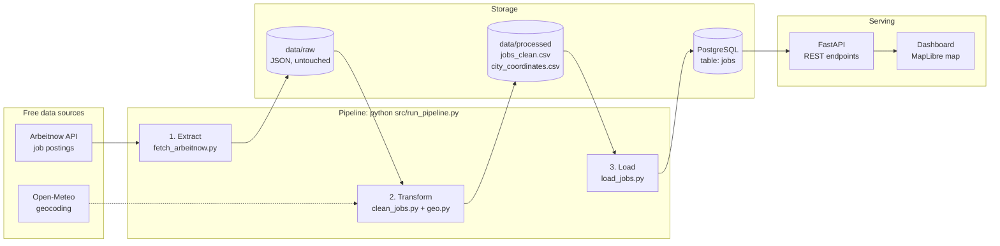
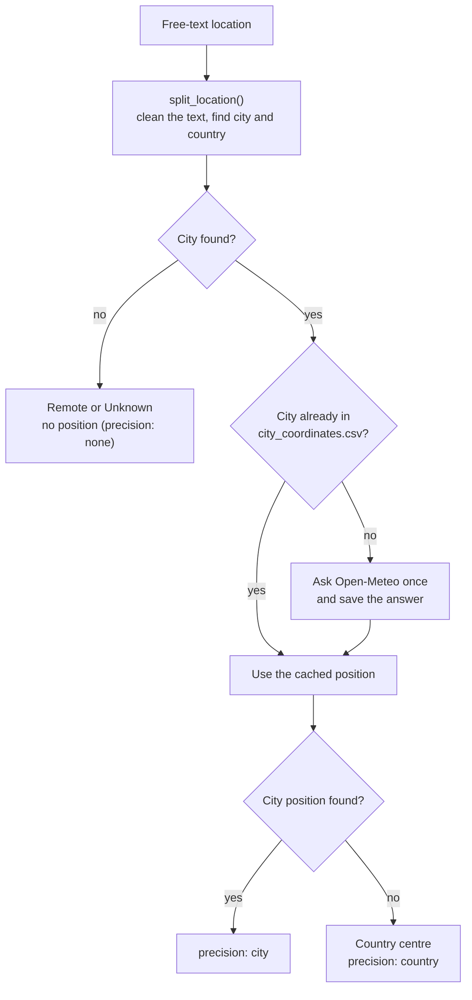

# Architecture

This page explains how the Global Job Market Intelligence Pipeline is built and why.

## Big picture

## The three pipeline steps

| Step | File | Input | Output | What it does |
|---|---|---|---|---|
| 1. Extract | `src/ingestion/fetch_arbeitnow.py` | Arbeitnow API | `data/raw/arbeitnow_<time>.json` | Downloads 5 pages (about 1,500 jobs), waits 1 second between requests, retries 3 times, saves the answer unchanged |
| 2. Transform | `src/transformation/clean_jobs.py`, `geo.py` | newest raw file | `data/processed/jobs_clean.csv` | Removes bad rows and duplicates, detects job type and work mode, works out country and city, adds coordinates |
| 3. Load | `src/database/load_jobs.py` | `jobs_clean.csv` | table `jobs` | Creates the table if needed and inserts new jobs or updates existing ones |

`src/run_pipeline.py` runs the three steps in order and stops at the first failure. It writes a summary with the time of every step and keeps a log in `logs/pipeline.log`.

## How the location of a job is found

The source only gives free text such as `Berlin`, `Wien, Austria` or `Paris Office`. Three layers turn it into a map position:

If the country was unknown, it is taken from the geocoding answer (for example `Baar` becomes Switzerland). If the online service fails five times in a row, the lookup stops and the progress is saved, so the next run continues where it stopped.

## Data model

Table `jobs` (primary key `job_id`, unique `url`). Indexes exist on `country`, `job_type`, `posted_at` and `(company, city)`. `location_precision` tells how exact the position is: `city`, `country` or `none`.

## API and dashboard

The dashboard never talks to the database directly. It asks the API:

| Dashboard action | API call |
|---|---|
| Open the map | `GET /map-markers`, `GET /stats` |
| Search for a country or apply quick filters | `GET /map-markers?work_mode=...&job_type=...`; country names are suggested from returned map data |
| Zoom in beyond level 4.5 | `GET /company-markers` for the visible map area |
| Click a country bubble | `GET /companies?country=...`, `GET /jobs?country=...` |
| Click a company logo | `GET /jobs?company=...&city=...` |
| Tick or untick Jobs / Internships | `GET /map-markers?jobs=...&internships=...` |
| Zoom in to company markers | `GET /company-markers` with the map bounds and active country, work-mode, and job-type filters |

Login and registration call `POST /auth/login` and `POST /auth/register`. Successful requests return a random bearer token; the database stores only its SHA-256 hash in `auth_sessions`. Passwords use salted scrypt hashes in `users`. The dashboard validates the session with `GET /auth/me` and revokes it with `POST /auth/logout`. The API creates the account tables on the first auth request, and `sql/001_create_tables.sql` includes them for manual setup too.

## Design decisions

- **Raw data is kept unchanged.** If the cleaning rules change later, the cleaning can be run again on the same raw files.
- **Re-runs are safe.** The load uses `INSERT ... ON CONFLICT (job_id) DO UPDATE`, so there are no duplicates and better data replaces older values.
- **Geocoding results are cached.** Each city is requested only once. This keeps the pipeline fast and is polite to the free service.
- **SQL uses parameters.** User input never goes into the SQL text, which prevents SQL injection. A test checks this.
- **Secrets stay out of Git.** Database settings are read from `.env`, which is listed in `.gitignore`.
- **Two map levels.** Zoomed out there is one bubble per country; zoomed in there is one logo per company and city. Overlapping markers are hidden, so the map stays readable at every zoom level.
- **Everything is free.** No paid API and no API key is required (the Logo.dev key is optional).

## Testing

`pytest` runs 70 tests in about two seconds. They need no internet and no database, because the online city service is replaced by a small fake function.

| Test file | What it checks |
|---|---|
| `tests/test_geo.py` | location cleaning, country names, city cache, geocoding logic |
| `tests/test_clean_jobs.py` | job type, work mode, dates, duplicates, bad rows |
| `tests/test_api_queries.py` | SQL building, filters, limits, injection safety |
| `tests/test_run_pipeline.py` | step order, stopping on failure, command line options |
